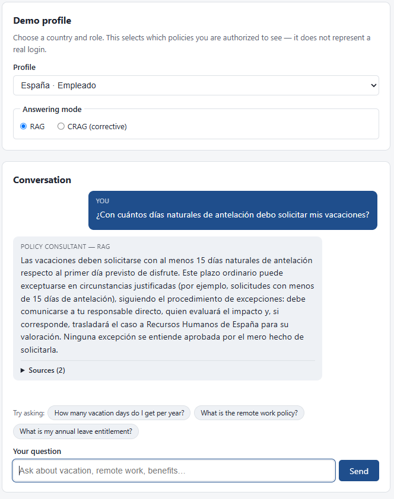
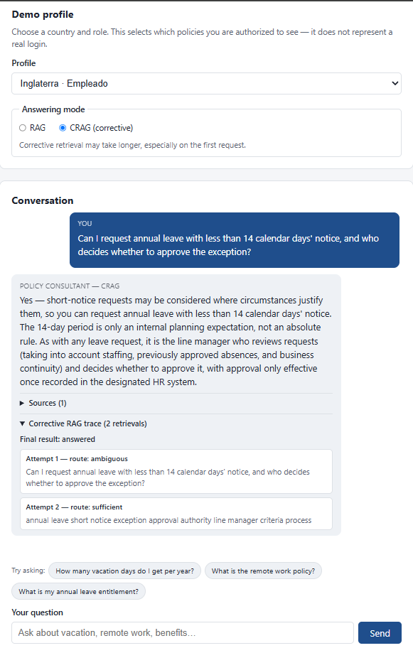
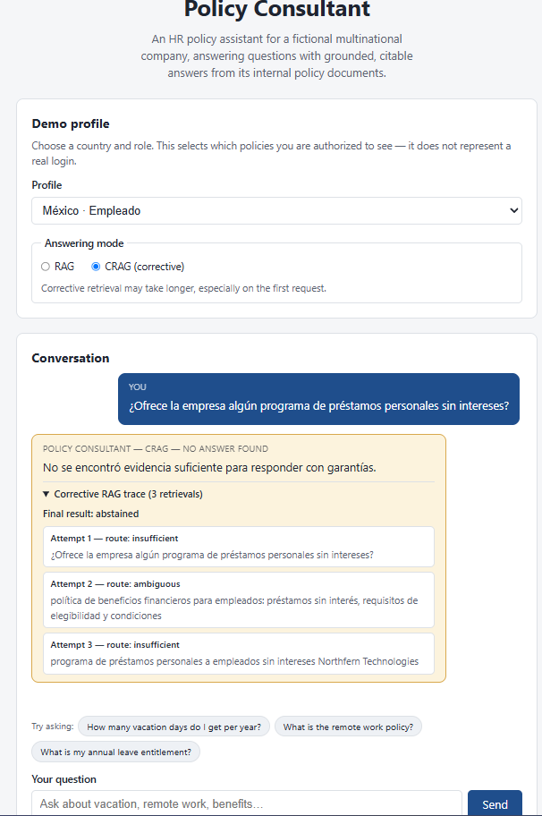
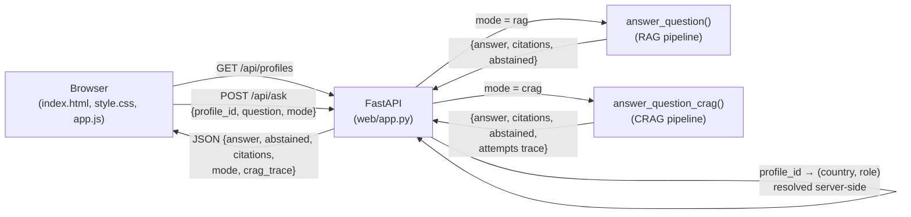
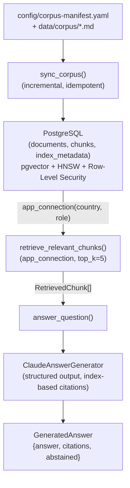
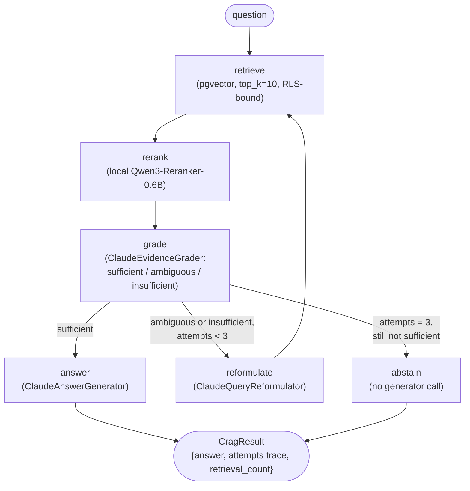

# Policy Consultant — RAG & CRAG

An AI-powered HR policy assistant for **Northfern Technologies**, a fictional multinational company operating in Spain, Mexico, and England ([company profile](docs/northfern-company-profile.md)).

The project explores Retrieval-Augmented Generation (RAG) and its evolution into Corrective RAG (CRAG), answering employee questions with **evidence-grounded, citable answers** while strictly respecting country-specific policies and role-based access restrictions — enforced in PostgreSQL itself via Row-Level Security, not in application code. Both pipelines are implemented, evaluated against the same held-out question set, and selectable side by side from the same web demo.

All company information, policies, and employee data used in this project are fictional.

## Evaluation Highlights

| | RAG | CRAG |
|---|---:|---:|
| Correct and complete (qualitative review) | 85% | 95% |
| Matches the expected outcome (answer/abstain) | 95% | 100% |

**398 automated tests pass.** The two rows above come from a single run of each pipeline over the same independent 20-question set (never used to tune either pipeline), with "correct and complete" determined by an AI-assisted qualitative review of each answer against its cited policy text. See [Evaluation](#evaluation) for the full table, methodology, and limitations — these two numbers are not the whole picture.

## Web Demo Preview

These screenshots illustrate the web demo's actual behavior in each mode — they are not new evaluation results, and the correction screenshot in particular is not a demonstration of complete factual correctness (see [Evaluation](#evaluation) and [Limitations](#limitations) for what was actually measured).



**RAG — Direct answer:** Policy-grounded answer with document citations.



**CRAG — Corrective retrieval:** Query reformulation following an ambiguous evidence assessment.



**CRAG — Abstention:** Insufficient evidence after three retrieval attempts.

## Current Status

Both pipelines are implemented, tested, manually validated, and evaluated against the same held-out question set, with real embeddings, real local reranking, and real LLM calls throughout:

- **Corpus**: 12 current fictional policy documents plus one superseded version, in Spanish and English, with country/role scoping, indexed into 163 chunks ([corpus inventory](docs/corpus-inventory.md)).
- **PostgreSQL + pgvector**: schema, roles, Row-Level Security policies, and an HNSW approximate-nearest-neighbor index on `chunks.embedding` (`migrations/004_chunks_embedding_hnsw_index.sql`).
- **Embeddings**: BGE-M3 (1024 dimensions), run locally, with a pinned Hugging Face revision for reproducibility.
- **RAG baseline**: pgvector cosine-distance retrieval (`top_k=5`) → Claude Sonnet 5 generation, with structured outputs and index-based citation resolution.
- **CRAG**: a LangGraph-orchestrated correction loop — retrieve → local rerank → grade evidence sufficiency → generate or reformulate and retry (up to twice) → generate or abstain. See [Architecture](#architecture) below.
- **Web demo**: a FastAPI app (`web/app.py`) exposing `GET /api/profiles` and `POST /api/ask`, with a `mode` field selecting `"rag"` (default) or `"crag"` per request — both backed by the exact same implemented pipelines, nothing duplicated in the web layer. See [Running the Web Demo](#running-the-web-demo).
- **Calibration and evaluation are complete for both pipelines**: RAG's retrieval distances were calibrated against 8 questions; CRAG's evidence-sufficiency prompt was calibrated against 12 independent questions and then frozen; a final, independent 20-question set was run once through each pipeline and manually reviewed. See [Evaluation](#evaluation) below.
- **398 automated tests** (112 of them integration tests against a real PostgreSQL instance), plus manual smoke tests against the real corpus with real Anthropic calls, and a manual end-to-end run through the web demo in both modes. See [Quality and Tests](#quality-and-tests).

## Architecture

### Web Request Flow

The web demo's only backend code is `web/app.py`: it resolves a request's `profile_id` into `(country, role)` server-side, then dispatches to either pipeline based on `mode` — no RAG or CRAG logic is duplicated in the web layer, and no RLS logic is implemented there either.



`profile_id` is the only identity a client ever sends — the browser never sends `country`/`role` directly, and nothing treats `profile_id` as a verified identity. **This is a demonstration of PostgreSQL's Row-Level Security isolation between a fixed set of demo profiles, not an authentication system**: there are no sessions, cookies, logins, or password checks anywhere in this project. A real deployment would authenticate the user first and derive `country`/`role` from a verified identity, never from a client-chosen `profile_id`.

### RAG Pipeline



### CRAG Pipeline



Evidence accumulates across attempts rather than being discarded wholesale: on `ambiguous`, the chunks the grader marked useful are kept and merged (deduplicated by `chunk_id`, already-kept entries take priority) with the next attempt's reranked results; on `insufficient`, the entire pool is discarded, since nothing in it was judged useful. The hard cap of 3 retrievals (1 initial + up to 2 reformulated retries) is enforced in Python by the graph's own routing (`crag.MAX_RETRIEVALS`), never left to the grader or reformulator to decide when to stop. Every retrieval — including the ones that follow a reformulation — runs through the same RLS-bound `app_connection()` the caller opened, so a chunk unauthorized for that profile can never enter the evidence pool, on any attempt.

The local reranker (`reranking.LocalQwen3RerankerModel`) scores each `(query, chunk)` pair from the logits of Qwen3-Reranker-0.6B's literal "yes"/"no" tokens, following its documented ChatML prompt format, never a separate classification head — a relevance *signal* derived from those logits, not a calibrated probability or a measure of evidence sufficiency. A high rerank score can still mean "topically right, substantively incomplete" — that judgment is `grade`'s job, not `rerank`'s.

### Core modules (`src/policy_consultant/`)

| Module | Responsibility |
|---|---|
| `corpus_manifest.py` | Load and validate `config/corpus-manifest.yaml` against the access-control vocabulary (`config/access-model.yaml`). |
| `ingestion.py`, `chunking.py`, `indexing_prep.py` | Turn current policy documents into a lazy stream of structurally-chunked, numbered fragments. |
| `embedding.py` | `EmbeddingModel` protocol + `LocalBgeM3EmbeddingModel`, a pinned-revision local BGE-M3 wrapper. |
| `migrations.py` + `migrations/*.sql` | A minimal, ordered SQL migration runner (no ORM, no migration framework). |
| `db.py` | `admin_connection()` (unrestricted) and `app_connection()` (RLS-bound, authenticated as the read-only `policy_app` role) — the only two ways this project talks to PostgreSQL. |
| `persistence.py` | `persist_document()` — atomic per-document upsert + full chunk replacement; `verify_embedding_model_compatibility()`. |
| `sync.py` | `sync_corpus()` — reconciles the manifest against PostgreSQL: inserts, version updates, metadata-only updates, and safe no-ops, without ever re-embedding an unchanged document. |
| `retrieval.py` | `retrieve_relevant_chunks()` — pgvector cosine-distance search; carries no authorization logic of its own. |
| `generation.py` | `AnswerGenerator` protocol + `ClaudeAnswerGenerator`; citation resolution by index; `AnswerGenerationError`. |
| `rag.py` | `answer_question()` — the thin orchestration tying retrieval and generation together (the RAG baseline). |
| `reranking.py` | `Reranker` protocol + `LocalQwen3RerankerModel` (Qwen3-Reranker-0.6B, local inference); `MAX_CANDIDATES=10`. |
| `grade_evidence.py` | `EvidenceGrader` protocol + `ClaudeEvidenceGrader`; structured `sufficient`/`ambiguous`/`insufficient` judgment; `EvidenceGradingError`. |
| `reformulate.py` | `QueryReformulator` protocol + `ClaudeQueryReformulator`; rejects a reformulation that's identical to the previous query; `QueryReformulationError`. |
| `crag.py` | `answer_question_crag()` — the LangGraph-orchestrated CRAG pipeline described above; `MAX_RETRIEVALS=3`. |
| `language.py` | A small, dependency-free Spanish/English heuristic used to localize the project's own abstention messages. |

### Web demo (`web/`)

A consumer of `policy_consultant`, never the reverse — nothing in `src/policy_consultant/` imports from `web/`.

| File | Responsibility |
|---|---|
| `app.py` | FastAPI app: `DEMO_PROFILES` (fixed `profile_id → (country, role)` list), `GET /api/profiles`, `POST /api/ask` (dispatches to RAG or CRAG by `mode`), a `lifespan` that loads the access model, BGE-M3, and the Claude generator once at startup, and `_get_crag_components()`, which lazily loads and caches the reranker/grader/reformulator on first CRAG use (see [Running the Web Demo](#running-the-web-demo)). |
| `static/index.html`, `style.css`, `app.js` | The demo page itself — plain HTML/CSS/vanilla JS, no framework, no build step, served as static files by the same FastAPI app. |

## Tech Stack and Key Decisions

- **Python 3.12**, managed with [`uv`](https://docs.astral.sh/uv/).
- **PostgreSQL 17 + pgvector** (via Docker Compose) for storage and vector search — no separate vector database.
- **psycopg 3** for database access, in autocommit mode with explicit `conn.transaction()` blocks for every atomic unit of work. No ORM, no connection pooling.
- **BGE-M3** (via `sentence-transformers`), run locally rather than through a hosted embeddings API, with its exact Hugging Face revision pinned in code for reproducible vectors.
- **An HNSW index** on `chunks.embedding` (`vector_cosine_ops`, pgvector's default build parameters) — added for a reproducible ANN path and for its own sake as a learning/portfolio exercise; at this corpus's scale (163 chunks) the query planner may still prefer a sequential scan, which is expected and documented, not a bug.
- **Qwen3-Reranker-0.6B**, run locally, for CRAG's rerank step — chosen and feasibility-checked (latency, VRAM) against the real model before committing to it, rather than assumed.
- **LangGraph**, used *only* for CRAG's retrieve/rerank/grade/reformulate/answer/abstain orchestration — the RAG baseline has no graph at all, by design; LangGraph was not introduced until CRAG's control flow (conditional retries with a hard cap) actually needed it.
- **Row-Level Security** is the actual authorization mechanism: `policy_app` is a non-superuser, read-only Postgres role bound to policies that filter `documents`/`chunks` by `app.country`/`app.role`. The application layer never implements its own access-control filtering, in either pipeline.
- **Anthropic Claude Sonnet 5** for generation, evidence grading, and query reformulation, via the official `anthropic` SDK, using **structured outputs** (`messages.parse()` against a Pydantic schema) so every one of those three model responses is schema-validated rather than parsed out of free text.
- **Citations are resolved by index, never by trusting the model's prose**, in both pipelines. The model receives a fixed, numbered list of already-authorized chunks and may only report which *numbers* it used; an answer with zero valid citations is never presented as grounded.
- **FastAPI serving plain HTML/CSS/vanilla JS** for the web demo: no React/Vue, no Node.js/npm, no build step, no separate frontend server or CORS configuration. There are no sessions, cookies, or authentication — a request's `profile_id` is resolved to `(country, role)` entirely server-side, from a fixed list, never accepted as a request field.
- **No framework for framework's sake, beyond LangGraph where it earns its keep**: no generic repository/ORM layers, no connection pools, no NLP dependency for a two-language heuristic. Every abstraction introduced (e.g. the `EmbeddingModel`/`AnswerGenerator`/`Reranker`/`EvidenceGrader`/`QueryReformulator` protocols) exists specifically to make a provider swappable without rewriting callers.

## Project Structure

```
config/                   Corpus manifest and access-control vocabulary (YAML)
data/corpus/              Current policy documents
data/archive/             Superseded document versions (versioning test cases)
docs/                     Company background, corpus design, and evaluation documentation
docs/evaluation/          Calibration/validation/evaluation datasets, results, and reports
migrations/               Ordered SQL migrations (schema, roles, RLS, grants, HNSW index)
scripts/                  Runnable entry points (see "Running the Project")
scripts/evaluation/       Calibration and evaluation scripts (see "Evaluation")
src/policy_consultant/    Application code (see "Core modules" above)
web/                      FastAPI demo app + static HTML/CSS/JS frontend (see "Web demo" above)
tests/                    Unit tests + integration tests (pytest, marker "integration")
tests/evaluation/         Tests for the calibration/evaluation scripts' own pure logic
tests/web/                Tests for the FastAPI app, both modes (fakes for every model/provider)
compose.yaml              PostgreSQL + pgvector service
.env.example              All environment variables this project actually reads
```

## Environment Setup

```bash
# Base install (manifest validation, no DB/embeddings/LLM needed)
uv sync

# Everything needed to run the RAG pipeline against PostgreSQL (no web UI, no CRAG)
uv sync --extra embeddings --extra persistence --extra generation

# Everything needed to run CRAG from a script (no web UI)
uv sync --extra crag

# Everything needed to run the web demo, in either mode — this alone is
# enough, it pulls in the crag extra (and, through it, persistence/
# reranking/generation) plus embeddings
uv sync --extra web
```

| Extra | Adds | Needed for |
|---|---|---|
| `embeddings` | `sentence-transformers`, `torch` (CUDA 12.6 wheel index) | Running BGE-M3 locally |
| `persistence` | `psycopg[binary]`, `python-dotenv` | Everything that talks to PostgreSQL |
| `generation` | `anthropic` (pydantic comes in transitively) | `ClaudeAnswerGenerator` |
| `reranking` | `transformers` (plus `embeddings`, for `torch`) | `LocalQwen3RerankerModel` |
| `crag` | `langgraph` (plus `persistence`, `reranking`, `generation`) | `crag.answer_question_crag` and its evaluation/smoke-test scripts |
| `web` | `fastapi`, `uvicorn` (plus `crag` and `embeddings`, self-referenced) | Running `web/app.py` in either mode (see [Running the Web Demo](#running-the-web-demo)) |

Copy `.env.example` to `.env` and fill in the real values. These are the environment variables this project's code actually reads — no others:

- PostgreSQL connection settings (`POSTGRES_*`, `DATABASE_*`) and the bootstrap password for the restricted `policy_app` role (`POLICY_APP_PASSWORD`).
- `EMBEDDING_DEVICE` (`cpu` by default; set to `cuda` for a GPU) — used by every script and by the web app for local BGE-M3 inference.
- `RERANKER_DEVICE` (`cpu` by default; set to `cuda` for a GPU) — used by `scripts/evaluation/run_crag_evaluation.py`, `scripts/smoke_test_crag.py`/`smoke_test_reranker.py`, and the web app's lazily-loaded reranker, for local Qwen3-Reranker-0.6B inference.
- `RERANKER_MODEL_ID` — read **only** by `scripts/smoke_test_reranker.py` (that script's own standalone reranker feasibility check); every other caller of `LocalQwen3RerankerModel` (the web app, the CRAG evaluation script, `smoke_test_crag.py`) uses the class's own default (`Qwen/Qwen3-Reranker-0.6B`) and does not read this variable.
- `ANTHROPIC_API_KEY` — required for `ClaudeAnswerGenerator`, `ClaudeEvidenceGrader`, and `ClaudeQueryReformulator` alike. **This project's own code never reads `.env` implicitly** — every script and the web app call `load_dotenv()` themselves, and nothing ever logs or prints the key.

Model identifiers are not configured via environment variables: `claude-sonnet-5` (generation, evidence grading, and query reformulation alike) and `BAAI/bge-m3` (embeddings) are constructor defaults/constants in code.

Start PostgreSQL and apply migrations:

```bash
docker compose up -d
uv run python scripts/apply_migrations.py
```

## PostgreSQL, pgvector, BGE-M3, and Access Control

- **Schema** (`migrations/001_schema.sql`): `documents` (one row per policy, reflecting only its current version), `chunks` (`embedding VECTOR(1024)`, foreign-keyed to `documents` with `ON DELETE CASCADE`), and `index_metadata` (a singleton row recording which embedding model/revision/dimensionality built the live index).
- **Roles and RLS** (`migrations/002_security.sql`, `003_policy_app_index_metadata_read.sql`): `policy_consultant_admin` is the unrestricted superuser used for migrations and writes; `policy_app` is a non-superuser, `NOBYPASSRLS` role with `SELECT`-only grants, bound to RLS policies that only return rows matching the session's `app.country`/`app.role` (set via `set_config(..., true)` inside a single transaction — see `db.app_connection()`). This same RLS boundary applies identically whether the caller is RAG's single retrieval or one of CRAG's up-to-three retrievals, including every one that follows a reformulation.
- **HNSW index** (`migrations/004_chunks_embedding_hnsw_index.sql`): an approximate-nearest-neighbor index on `chunks.embedding` using `vector_cosine_ops`, the same operator class backing the `<=>` operator `retrieval.retrieve_relevant_chunks()` already used — this migration changes only how PostgreSQL *may* execute the search, never what rows are candidates or their RLS filtering.
- **`index_metadata`** lets both `persist_document()` (admin) and `verify_embedding_model_compatibility()` (admin **or** app connection) detect a mismatched embedding configuration before writing or serving anything — there is no silent mixing of embeddings from different models/revisions.
- The full schema rationale, versioning policy, and access model are documented in [`docs/corpus-inventory.md`](docs/corpus-inventory.md).

## Corpus Sync, Embeddings, and Retrieval

`scripts/sync_corpus.py` reconciles `config/corpus-manifest.yaml` against PostgreSQL:

```bash
uv run python scripts/sync_corpus.py
```

It is safe to run repeatedly — `sync_corpus()` classifies every document as a new insert, a real version update (only if `effective_from` actually advances — never a downgrade), a metadata-only update (e.g. `allowed_roles`, no re-embedding), unchanged, a rejected stale version, a metadata conflict requiring human review, or missing from the manifest (reported, never silently deleted). Only documents that actually need new embeddings go through BGE-M3 again.

`retrieval.retrieve_relevant_chunks()` runs a parameterized `ORDER BY embedding <=> %s::vector LIMIT %s` query over whatever `app_connection(country=..., role=...)` the caller provides — RLS does all the authorization; the function carries none of its own. Both RAG (directly) and CRAG (inside its `retrieve` step, re-embedding each reformulated query before calling it again) build on this exact same function.

## RAG Flow: Generation, Citations, and Abstention

`rag.answer_question(conn, question, query_embedding=..., generator=..., top_k=...)` is the RAG baseline's single entry point:

1. If retrieval returns no chunks at all, the generator is never called — the answer is an immediate, localized abstention.
2. Otherwise, `ClaudeAnswerGenerator` builds a numbered context block from the (already RLS-authorized) chunks, asks Claude for a structured `{answer, abstain, cited_indices}` response, and resolves `cited_indices` back to the real chunks **by position** — an out-of-range or duplicate index is dropped, never trusted.
3. An answer with zero valid citations is never presented as grounded, even if the model didn't flag `abstain`; it is forced into an abstention instead.
4. Abstention messages are localized to the question's language (Spanish or English — see `language.py`) via a minimal heuristic, with no NLP dependency.
5. Errors are never silently swallowed into a fabricated answer, and the two failure categories are kept distinct on purpose:
   - **Transport and rate-limit failures** (connection errors, 5xx, rate limiting, authentication) propagate as the Anthropic SDK's own typed exceptions, unwrapped — a caller can apply the SDK's own retry guidance directly.
   - **Refusals, truncated output, and invalid structured output** are raised as `generation.AnswerGenerationError` — "the provider answered, but the answer can't be trusted," a different failure mode from a transport problem, and deliberately not the same exception type.

## CRAG Flow: Correction, Reformulation, and Abstention

`crag.answer_question_crag(conn, question, embedding_model=..., reranker=..., grader=..., reformulator=..., generator=...)` is CRAG's single entry point — see the diagram and evidence-accumulation rules in [Architecture](#architecture) above for the graph itself. In addition to that:

- `grade_evidence.ClaudeEvidenceGrader` never just checks topical relevance (that's the reranker's job): it judges whether the *pool* of kept-plus-newly-reranked chunks, taken together, covers every aspect the original question actually asks — a route of `"sufficient"` requires full coverage, not "mostly relevant." A `route="sufficient"` with zero chunks surviving the authorized-pool filter is defensively downgraded to `"insufficient"` by the graph itself (the grade step inside `crag._build_graph`), never trusted blindly from the grader.
- `reformulate.ClaudeQueryReformulator` is told exactly which aspects the grader marked missing, and must produce a genuinely different query — an identical-after-normalization reformulation raises `QueryReformulationError` rather than silently retrying the same search.
- `EvidenceGradingError`/`QueryReformulationError`/`AnswerGenerationError` all propagate unwrapped out of `answer_question_crag` on a genuine provider-side failure — these are never recorded as a legitimate abstention, in the web app or in the evaluation scripts.
- An abstention after exhausting all 3 retrievals returns the same kind of localized, no-citations `GeneratedAnswer` RAG's zero-evidence path returns — but CRAG's `abstain_node` never calls the generator at all, so (unlike RAG, whose generator — when it is called, i.e. whenever retrieval returned at least one chunk — can explain *why* it can't answer from whatever it was given) CRAG's abstention message is a fixed, generic string, not a model-written explanation grounded in whatever partial evidence was kept. This is a real difference in how informative the two pipelines' abstentions are — see [Limitations](#limitations).

## Running the Project

```bash
# Validate the manifest only (no DB needed)
uv run python scripts/validate_manifest.py

# Apply pending migrations
uv run python scripts/apply_migrations.py

# Sync the corpus into PostgreSQL (safe to re-run)
uv run python scripts/sync_corpus.py

# Manual smoke tests (real BGE-M3 / real local reranker / real Anthropic
# calls — never part of the automated suite)
uv run python scripts/smoke_test_embedding.py
uv run python scripts/smoke_test_rag.py
uv run python scripts/smoke_test_reranker.py
uv run python scripts/smoke_test_crag.py
```

### Tests

```bash
# Everything that doesn't need PostgreSQL
uv run pytest -m "not integration"

# Everything that does (requires `docker compose up -d` first)
uv run pytest -m integration

# The full suite
uv run pytest
```

As of this writing: **398 tests pass**, **112** of them integration tests against a real PostgreSQL instance — no skipped tests when PostgreSQL is reachable. Every test (RAG's and CRAG's, `tests/web/` included) uses fakes for whichever models/providers it isn't specifically exercising — never real BGE-M3 weights, never a real local reranker, never a real Anthropic call — so the automated suite never depends on any of them. See [Quality and Tests](#quality-and-tests) for the full verification command set.

## Running the Web Demo

Once PostgreSQL is running, migrations are applied, and the corpus is synced (see "Environment Setup" and "Corpus Sync, Embeddings, and Retrieval" above — `uv sync --extra web` covers every dependency needed for this, including CRAG's):

```bash
uv run uvicorn web.app:app --reload
```

Then open <http://127.0.0.1:8000/> in a browser:

1. Pick a **demo profile** from the dropdown (e.g. "España · Empleado", "España · RR. HH."). Each profile is a fixed `(country, role)` pair defined in `web/app.py`'s `DEMO_PROFILES` — the browser only ever sends a `profile_id`; the server resolves the country/role and opens the corresponding RLS-bound `app_connection()` itself.
2. Pick an **answering mode** — RAG or CRAG. RAG is selected by default, and a client that omits `mode` entirely gets exactly RAG's behavior (the field is optional and additive to the API, for backward compatibility). Selecting CRAG shows a short note: *"Corrective retrieval may take longer, especially on the first request."*
3. Type a question (or click one of the example questions) and press **Send**.
4. The answer appears in the chat, labeled with which pipeline produced it ("Policy Consultant — RAG" or "Policy Consultant — CRAG"), and visually distinguished as a grounded answer, an abstention, or a technical error. Each answer's expandable **Sources** section shows the exact cited document id, version, section, and fragment text — the same component is reused for both modes. A CRAG answer also shows an expandable **Corrective RAG trace**: the number of internal retrievals, the final result (answered/abstained), and, per attempt, the exact query searched for and the route (`sufficient`/`ambiguous`/`insufficient`) the grader resolved to.
5. Switching **mode** mid-conversation keeps the chat history, so a RAG answer and a CRAG answer to the same question can sit side by side for visual comparison. Switching **profile**, by contrast, clears the chat history — a different profile means a different RLS context, so carrying over answers grounded under the previous one would be misleading. Changing either mid-request immediately invalidates that request's answer in the UI (it is simply never displayed, and the "Thinking…" state and Send button are reset right away) — but this only stops the browser from *showing* the stale answer; the request already sent is not necessarily cancelled on the server, which may still finish computing and discard it there.

**Profile selection is not authentication.** It only demonstrates PostgreSQL's Row-Level Security isolation between countries and roles — it never verifies who is actually making the request. There are no sessions, cookies, or logins anywhere in this demo; `profile_id` is resolved to `(country, role)` entirely server-side on every request, exactly the same way for both modes.

**CRAG's reranker/grader/reformulator are loaded lazily**, on the first `mode="crag"` request the running process ever handles — never at startup, and never at all if every request stays on `mode="rag"`. The first CRAG request in a process's lifetime is therefore noticeably slower than later ones (loading the local reranker's weights), independently of CRAG's own larger per-question latency (see [Limitations](#limitations)); a lock around that one-time construction prevents loading the reranker twice if two CRAG requests race, without serializing any CRAG request against another once it's loaded.

| Method & Path | Purpose |
|---|---|
| `GET /` | Serves the demo page (`web/static/index.html`). |
| `GET /static/...` | Serves `style.css` and `app.js`. |
| `GET /api/profiles` | Returns the fixed list of demo profiles (`id`, `label`). |
| `POST /api/ask` | Body: `{"profile_id": "...", "question": "...", "mode": "rag" \| "crag"}` (`mode` optional, defaults to `"rag"`). Returns `{"answer", "abstained", "citations", "mode", "crag_trace"}` — `crag_trace` is `null` for `mode="rag"`, and otherwise `{"retrieval_count", "attempts": [{"attempt", "query", "route"}, ...]}`. Each citation includes `document_id`, `version`, `section_path`, `chunk_id`, and `text`. |

## Evaluation

Three independent question sets support this project's evaluation history — none reused across stages, each verified against the real indexed corpus rather than invented (see [`docs/evaluation/`](docs/evaluation/) for every dataset/result/report referenced below):

- **RAG calibration** (8 questions, [`calibration-questions.yaml`](docs/evaluation/calibration-questions.yaml)) — studied real retrieval distances only; see below.
- **CRAG calibration** (12 questions, [`crag-validation-questions.yaml`](docs/evaluation/crag-validation-questions.yaml)) — used to observe CRAG's real behavior and calibrate `grade_evidence`'s prompt ([initial run](docs/evaluation/crag-validation-initial-report.md) → one prompt adjustment → [calibrated run](docs/evaluation/crag-validation-calibrated-report.md)), before the configuration was frozen.
- **Final, independent comparison set** (20 questions: 14 answerable + 6 abstain, [`crag-evaluation-questions.yaml`](docs/evaluation/crag-evaluation-questions.yaml)) — built after CRAG's configuration was already frozen, never used to tune either pipeline, and run exactly once through each.

### RAG calibration result: no fixed relevance threshold

`scripts/evaluation/calibrate_threshold.py` measured real cosine distances (pgvector's `<=>`: `0` = identical, `2` = opposite, lower = more relevant) for the 8 calibration questions. **The answerable and abstain distance distributions overlap**: two abstain questions had a closer first result (`0.320` and `0.342`) than the correct evidence for an answerable question (`0.385`) — so no single distance threshold can admit that answerable question without also admitting those abstentions. Full numbers: [`calibration-results.json`](docs/evaluation/calibration-results.json).

**Decision: no fixed threshold was introduced**, from this 8-question sample — in either pipeline. `retrieval.retrieve_relevant_chunks()` always returns its `top_k` nearest chunks regardless of distance. For RAG, abstention depends entirely on the generator recognizing it cannot answer plus the citation-resolution step. CRAG's answer to this same problem is structural rather than a single cutoff: `grade_evidence`'s sufficiency judgment, not a numeric threshold on distance or rerank score. No numeric reranking threshold was introduced for CRAG either, for the same reason: the CRAG calibration round surfaced no evidence that would justify adding one — no experimental comparison of CRAG with and without a threshold was performed.

### Final comparison (20 independent questions, one run per pipeline)

`scripts/evaluation/run_evaluation.py --run` and `scripts/evaluation/run_crag_evaluation.py --run` each ran their real pipeline once against the same 20-question set — same corpus, same embeddings, same profiles/RLS, same generator model and configuration (`claude-sonnet-5`, `disable_thinking=True`) — with CRAG's own additional configuration (reranker, grader, reformulator, `top_k=10`, up to 3 retrievals) kept exactly as frozen in calibration, never adjusted afterward. Full per-question results: [`rag-final-results.json`](docs/evaluation/rag-final-results.json)/[`rag-final-report.md`](docs/evaluation/rag-final-report.md) and [`crag-final-results.json`](docs/evaluation/crag-final-results.json)/[`crag-final-report.md`](docs/evaluation/crag-final-report.md). The full narrative comparison, including every limitation below, lives in [`docs/evaluation/rag-vs-crag-comparison.md`](docs/evaluation/rag-vs-crag-comparison.md) — this section only summarizes it.

| Metric | RAG | CRAG |
|---|---:|---:|
| Matches the expected outcome (answer/abstain) | 19/20 (95%) | 20/20 (100%) |
| Correct and complete, per manual review | 17/20 (85%) | 19/20 (95%) |
| Answerable questions answered correctly and completely | 11/14 | 13/14 |
| Expected-evidence coverage | 85.7% | 95.2% |
| Correct abstentions | 6/6 | 6/6 |
| False abstentions | 1 | 0 |
| Structurally valid citations | 26/26 | 30/30 |

**"Matches the expected outcome" and "structurally valid citations" are automatic, structural checks** — did the system answer when it should, abstain when it should, and does each citation reference a chunk the system actually retrieved and was handed. For CRAG specifically, this structural check has a second dimension RAG's single-retrieval design has no equivalent for: whether each citation points to a chunk that was part of the *exact* context handed to the generator on the final attempt, not merely retrieved at some earlier attempt and later discarded — both held at 100% in this run. **"Correct and complete" is an AI-assisted qualitative review**: each of the 40 answers (20 questions × 2 pipelines) was read against the real cited policy text and classified as correct, incomplete (right conclusion, missing a required aspect), or incorrect — a structurally valid citation says nothing about whether it actually supports the claim attached to it, which is exactly what this second pass checks.

Three questions were flagged for closer attention:

- **`eval-crag-13`**: RAG's `top_k=5` never retrieved one of the two chunks this question needs, and abstained incorrectly. CRAG recovered it in its second attempt — a reformulation, driven by the grader's own missing-aspect note, surfaced that chunk for the first time, and the final answer is correct and complete. This is real, observed evidence that the correction loop can recover evidence an uncorrected retrieval misses — but it's one case, not a controlled ablation, so it does not by itself prove how much of CRAG's overall advantage on this dataset comes specifically from the correction loop versus CRAG's other difference from RAG (`top_k=10` vs. `5`).
- **`eval-crag-11`**: both pipelines are incomplete, for the same underlying reason — a relevant chunk never entered either system's candidate pool (RAG's top 5, or CRAG's top 10 before reranking), so this is a shared retrieval gap, not a CRAG-specific weakness. CRAG does have one additional failure mode RAG structurally cannot have: its grader explicitly declared the (incomplete) evidence it did have `"sufficient"` — a defensible call given only what it saw, but retrospectively wrong against the full corpus, and because that declaration happened on the first attempt, the correction loop never got a chance to reformulate and look further.
- **`eval-crag-14`**: both pipelines cited the exact same two chunks, yet CRAG's generated answer covered more of what those chunks actually said (including a detail RAG's generation dropped). This cannot be attributed to CRAG's evidence-grading step feeding extra signal to the generator — it doesn't; the generator only ever sees the question and the chunks, in both pipelines. A real, verified difference is that RAG handed its generator 5 chunks (3 of them unrelated to the question) while CRAG handed its generator only the 2 relevant ones already filtered by the grader — a plausible explanation, not a confirmed one.

**Do not read this as CRAG unconditionally outperforming RAG.** CRAG matched or exceeded every automatic metric on this 20-question sample, and the qualitative review found a real, verified advantage in `eval-crag-13`, where a reformulation recovered evidence the initial retrieval missed — but `top_k=10` vs. `5` is a second, uncontrolled difference between the two pipelines, and no controlled ablation was run to separate the two effects, so some of the measured gap cannot be attributed to the correction loop specifically versus simply having more candidates to begin with. See the comparison report for the complete set of methodological limitations.

Reproduce either run (uses new, non-default output paths — this never overwrites the committed historical results above):

```bash
uv run python scripts/evaluation/run_evaluation.py --run \
    --questions docs/evaluation/crag-evaluation-questions.yaml \
    --results-json docs/evaluation/rag-rerun-results.json \
    --results-md docs/evaluation/rag-rerun-report.md

uv run python scripts/evaluation/run_crag_evaluation.py --run \
    --questions docs/evaluation/crag-evaluation-questions.yaml \
    --results-json docs/evaluation/crag-rerun-results.json \
    --results-md docs/evaluation/crag-rerun-report.md
```

Both scripts refuse outright if their `--results-json` target already exists, and make real, billed Claude API calls — never run without `--run`, which is required precisely so a bare invocation stays inert. In the evaluation run already behind the numbers above, RAG made 20 generator calls (one per question) and CRAG made 34 grading calls, 14 reformulation calls, and 14 generator calls in total; a reproduction run over a different or reordered question set would very plausibly produce different counts, since how many questions need correction (and how many retries each needs, up to the 3-retrieval cap) depends on the real, non-deterministic grader judgments made during that run.

## Limitations

- **Small corpus and small evaluation sets** (163 chunks; 8 RAG-calibration questions, 12 CRAG-calibration questions, 20 questions in the final comparison). No result here — RAG's, CRAG's, or the comparison between them — should be read as a statistically powered benchmark.
- **A single run per pipeline on the final comparison.** Both the generator and, for CRAG, the evidence grader are real LLM calls with real response variability; a repeat run could plausibly differ on a close call (see `eval-crag-13`'s own route sequence, which changed judgment between two attempts over the *same* evidence) without necessarily changing the final answer.
- **A grader can declare evidence "sufficient" while it's actually incomplete**, if nothing in the pool it was shown pointed to the gap (`eval-crag-11`). This is not a hypothetical: it's an observed, real case in the final comparison, and it is not something CRAG's current design detects on its own — there is no second check after `sufficient` is declared.
- **CRAG introduces additional operations and calls per question** that RAG's single retrieval and single generation call does not have — up to 3 retrievals, each with its own local reranking and grading call, plus a reformulation call for every retry. This project has not measured RAG's own per-question latency (its evaluation script was never instrumented for it) and makes **no claim about CRAG's comparative cost or latency relative to RAG** — only CRAG's own observed latency, in isolation, is reported (see [`docs/evaluation/rag-vs-crag-comparison.md`](docs/evaluation/rag-vs-crag-comparison.md)).
- **CRAG's abstention message is generic**, not a model-written explanation. Because `crag.abstain_node` never calls the generator, an abstention after exhausting all 3 retrievals gives no account of what partial evidence existed or why it still wasn't enough — unlike RAG, whose generator is called whenever retrieval returned anything at all, and can explain itself from whatever it saw (RAG's generator is skipped only on its own zero-evidence shortcut, when retrieval returns no chunks at all).
- **Demo profiles are not authentication.** `DEMO_PROFILES` is a fixed, backend-owned list for demonstrating RLS isolation; there is no login, session, or verified identity anywhere in this project, and `profile_id` must never be treated as one.

## Quality and Tests

```bash
uv run pytest                              # 398 tests (112 integration, 286 unit)
uv run ruff check .
uv run mypy .
uvx pyright --pythonpath .venv/Scripts/python.exe
```

All four pass clean as of this writing — there is no CI configured for this project; these are the exact commands run manually after each change. A handful of files outside the scope of this delivery have pre-existing formatting deviations under `ruff format --check`, left alone rather than reformatted as an unrelated change.

The manual smoke tests listed under [Running the Project](#running-the-project) are intentionally outside this automated set — they make real local-model and real Anthropic calls, by design never run in CI or by a bare `pytest` invocation.

## Disclaimer

Northfern Technologies and all associated people, policies, and employee data are entirely fictional, used for portfolio and learning purposes only.
